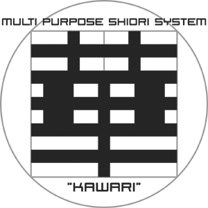

# 華和梨マニュアル

伺か（ukagaka）の SHIORI「華和梨（KAWARI）」のマニュアルです。華和梨の辞書の書き方、インラインスクリプト（KIS）のコマンド、コンソール版の幸水、仕様書をまとめています。

*To hack, or not to be... That is the Program!!*

> 「ですくとっぷ戦線ニ異常アリ」 — *"SOMETHING IS WRONG WITH THE DESKTOP FRONT."* （[ストーリー](other/story.md)）

間違いやわかりにくいところを見つけたら、[整備班BTS](https://bts.shillest.net/)（報告フォーム）で教えてください。GitHub に慣れている方は、[Issues](https://github.com/ukatech/kawari-docs/issues) や Pull Request でも構いません。

> AI エージェント向けに、探し方の案内 [llms.txt](https://ukatech.shillest.net/kawari-docs/llms.txt) を用意しています。各ページの Markdown 原稿は、リポジトリと同じパスの `.md`（例: `https://ukatech.shillest.net/kawari-docs/startup/getting-started.md`）で取得できます。

## ダウンロード・ソース

- [華和梨のリポジトリ（kawari）](https://github.com/ukatech/kawari)
- [ダウンロード（GitHub Releases）](https://github.com/ukatech/kawari/releases)

## はじめての方へ

- 華和梨って何？ → [華和梨とは](startup/what-is-kawari.md)
- はじめて華和梨でゴーストを作りたい → [導入ガイド](startup/getting-started.md)
- 華和梨 8（8.2.x）を使っていて Phase 9 に移りたい → [華和梨 8 から Phase 9 への乗り換え](migration/00-from-phase8.md)（`shiori.dll` を差し替えるだけで動きます）
- 華和梨 7 以前を使っていた → [移行ガイド](migration/01-overview.md)

## 調べたいとき

- 辞書の書き方を知りたい → [文法](grammar/01-dictionary-files.md)
- イベントや SAORI の扱いを知りたい → [SHIORI/SAORI インターフェース](shiori/index.md)
- KIS のコマンドを調べたい → [KIS リファレンス](kis/index.md)
- 幸水で動作確認・デバッグをしたい → [幸水](kosui/index.md)
- 機能を組むサンプルが見たい → [ヒント集](tips/index.md)
- エラーメッセージを調べたい → [エラーメッセージ一覧](other/error-messages.md)

ページ上部の検索窓からも探せます。サイトでは、左のメニューから全ページを辿れます。

## 配布条件

本プログラムはフリーソフトウェアであり、修正BSDライセンスに基づいて再配布可能です。詳しくは[ライセンス](other/license.md)を御覧下さい。

---

華和梨開発チーム: NAKAUE.T (Meister)、偽Meister (夢乃)、さとー、酔狂、さくらのにえ
